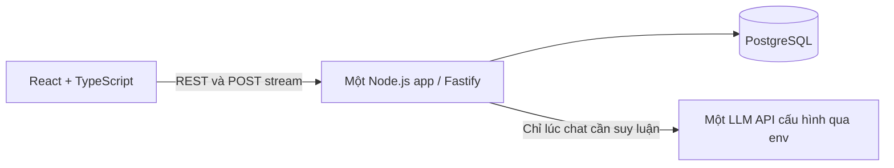
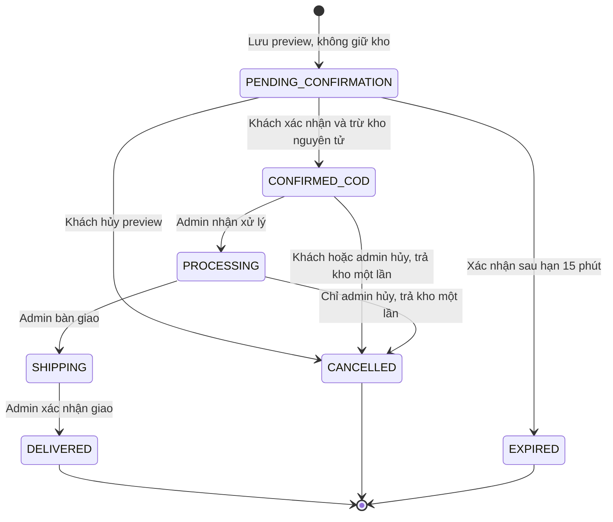
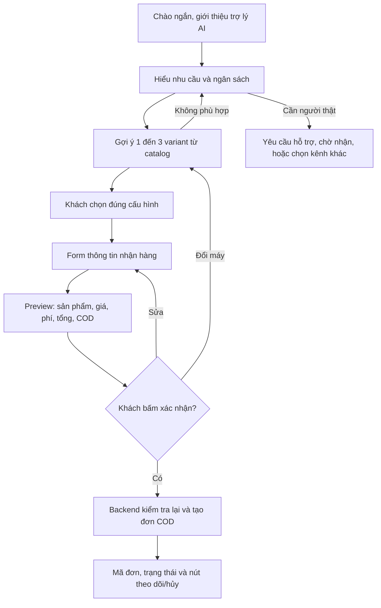

# LAPBOT — ĐẶC TẢ MVP CHO AI CODE

Phiên bản quyết định: MVP-1. Ưu tiên: đúng nghiệp vụ → đơn giản → hiệu năng có đo lường. Trạng thái: sẵn sàng bắt đầu triển khai MVP; chưa có ứng dụng hoặc số liệu benchmark.

Đây là nguồn yêu cầu triển khai chính. Các tài liệu `00`–`07` lưu ý tưởng, giao diện và thiết kế mở rộng trước đây; khi khác tài liệu này, áp dụng tài liệu này cho MVP. Không cộng tất cả tính năng của các tài liệu cũ vào backlog MVP.

## 1. Phạm vi đã chốt

| Làm trong MVP | Để giai đoạn sau |
| --- | --- |
| Danh mục laptop, lọc ngân sách/cấu hình, chi tiết variant | Huấn luyện ML riêng, semantic/vector search, RAG ingestion |
| Chat tiếng Việt, tool đọc catalog, widget có schema | Agent framework, classifier/sentiment chạy riêng, điểm confidence tự suy đoán |
| Guest checkout, một variant × một máy cho mỗi đơn, COD | Giỏ nhiều sản phẩm, tài khoản thành viên, tích điểm, voucher/quà tặng tự động |
| Form địa chỉ → xem trước → xác nhận → theo dõi đơn trong cùng session | VietQR, webhook ngân hàng, hoàn tiền và tích hợp vận chuyển |
| Admin đăng nhập, quản lý catalog/tồn kho, xử lý đơn, nhận chat cần hỗ trợ | WebSocket, Redis, queue, microservices, A/B testing, copilot |

MVP vẫn giữ luồng chat-to-order: chọn sản phẩm trong chat, điền form và xác nhận ngay trong khung chat. Thao tác mua hàng gọi API trực tiếp để giảm độ trễ và giảm phụ thuộc LLM.

Không giữ tồn kho khi chỉ xem preview. Preview có hạn **15 phút** để kiểm tra lại giá, không phải lời hứa giữ hàng. Tồn kho chỉ bị trừ khi khách xác nhận COD thành công. Hành vi này thay thế reservation/soft-lock trong tài liệu cũ cho MVP.

## 2. Kiến trúc và stack duy nhất



- npm workspace; `apps/web`: React + Vite + TypeScript; `apps/api`: Fastify + TypeScript; `packages/contracts`: TypeScript types và JSON Schema dùng chung.
- Một backend có module `catalog`, `chat`, `orders`, `admin`, `auth`. Module gọi hàm/service trong cùng process, không gọi HTTP qua lại.
- PostgreSQL + `pg`, SQL có tham số, migration `.sql` đánh số theo thứ tự và bảng `schema_migrations`. Không thêm ORM, Redis hoặc vector DB vào MVP.
- Fastify dùng JSON Schema cho request và response. Schema chỉ được định nghĩa trong code; không nhận schema từ model/user. Body có `additionalProperties:false`; cấu hình validator `removeAdditional:false`, `coerceTypes:false`, `allErrors:false` để trả 400 khi có trường thừa/sai kiểu, không âm thầm xóa/coerce. Query string được parse/coerce có kiểm soát theo schema riêng. Không viết lại kiểu dữ liệu riêng ở frontend.
- React dùng state cục bộ và một Context/useReducer cho chat/checkout. Một API client dùng `fetch`. Dùng React Router cho trang catalog, chi tiết và admin. Chưa cần Redux, Zustand, event bus hoặc thư viện cache truy vấn.
- Development: Vite proxy `/api` tới backend. Production: backend phục vụ build tĩnh React và `/api` cùng origin. Chạy một app instance + một PostgreSQL; không triển khai nhiều replica trước khi bổ sung phối hợp tác vụ chat.
- Lúc scaffold, chọn Node LTS còn được hỗ trợ và phiên bản package ổn định tương thích; ghi rõ trong `engines`, runtime config và commit lockfile. Không hardcode tên model cũ trong prompt.

Env tối thiểu: `DATABASE_URL`, `NODE_ENV`, `HOST`, `PORT`, `PUBLIC_ORIGIN`, `SHIPPING_FEE_VND`, `AI_ENABLED`, `LLM_MODEL`, `LLM_API_KEY`, `LOG_LEVEL`; base URL/provider được bổ sung theo adapter thực sự tích hợp ở bước 4. Chỉ tích hợp một provider, không xây bộ router nhiều hãng. `AI_ENABLED=false` là mặc định khi chưa có credential; nếu bật AI mà thiếu cấu hình thì startup báo rõ lỗi, không giả lập kết quả thật. Giá/phí và origin phải validate khi khởi động. Password tạo admin truyền vào lệnh seed riêng, không commit hoặc log.

Thêm file cấu hình `store-info.json` được shop duyệt: tên cửa hàng, ghi chú giá/thuế đã bao gồm trong giá bán, phạm vi giao hàng, chính sách bảo hành/đổi trả, giờ hỗ trợ, kênh liên hệ, liên kết chính sách. Nội dung này được version trong repo, trả qua `/store-info` và đưa gọn vào context khi cần; không cần RAG/embedding hay trang quản trị chính sách trong MVP. Số tiền phí giao hàng chỉ có một nguồn là `SHIPPING_FEE_VND`; `/store-info` trả giá trị này từ cấu hình runtime, không lưu thêm một con số phí trong JSON. Trường chưa được xác minh phải ghi chưa có thông tin, bot không tự tạo chính sách. Trước mở bán, shop phải xác nhận giá niêm yết và phí phản ánh đầy đủ số tiền thu COD.

### Cấu trúc đầu ra khi code

```text
apps/web/src/{pages,components/chat,components/catalog,components/checkout,lib}
apps/api/src/{modules,db,lib,server.ts}
apps/api/migrations/
apps/api/src/db/{seed.ts,vz-source.ts}
VZ_Data/                   # JSON và ảnh nguồn; giữ cùng ứng dụng để phục vụ ảnh
packages/contracts/src/
package.json
package-lock.json
.env.example
compose.yaml                 # PostgreSQL cho development
```

Hợp đồng đặt tên: API/DB dùng `snake_case`, UI có thể dùng `camelCase` nội bộ nhưng mapping tập trung ở API client. Resource ID dùng UUID; riêng chat_messages.id là BIGINT cursor và luôn serialize thành chuỗi thập phân để không mất độ chính xác trong JavaScript. Thời gian dùng TIMESTAMPTZ trong DB và ISO 8601 UTC ở API. Tiền dùng số nguyên VND; không dùng số thực. Mỗi giá từ 1 đến 1.000.000.000 VND, phí giao hàng từ 0 đến 10.000.000 VND; tổng của một đơn nằm trong miền INTEGER PostgreSQL. Đây là giới hạn MVP được kiểm tra ở cả schema và DB.

## 3. Dữ liệu tối thiểu

| Bảng | Trường và ràng buộc cần có |
| --- | --- |
| `laptops` | `id`, `brand`, `model_name`, `description`, `image_url`, `is_active`, `revision`, timestamps |
| `laptop_images` | `laptop_id` FK, `position` thứ tự ảnh, `image_url`, `caption`; khóa chính `(laptop_id, position)`. Ảnh VZ_Data đã tải thành công mới được nhập; caption trung tính từ tên máy và vị trí, không suy đoán góc chụp. |
| `laptop_variants` | `id`, `laptop_id` FK, `sku` unique, `cpu`, `gpu`, `ram_gb`, `ssd_gb`, `screen`, `color`, `usage_category`, `price_vnd` integer, `stock` integer CHECK >= 0, `source_in_stock` nullable boolean, `stock_verified` boolean, `is_active`, `revision`, timestamps |
| `customers` | `id`, `email` unique, `phone` unique nullable, `password_hash`, `full_name`, `default_shipping_address`, `is_active`, timestamps |
| `customer_sessions` | `id`, `customer_id` FK, `token_hash` unique, `expires_at`, timestamps |
| `chat_sessions` | `id`, `guest_token_hash` unique, `customer_id` nullable FK, `expires_at`, `control_mode` (`AI`/`AGENT`), `control_version`, `assigned_admin_id` nullable FK, `needs_human`, `human_requested_at` nullable, `sales_context` JSONB, timestamps |
| `chat_turns` | `id`, `session_id` FK, `client_message_id` UUID, `request_hash`, `generation_version` nullable, `status` (`PROCESSING`/`COMPLETED`/`INTERRUPTED`/`FAILED`/`FORWARDED`), `model_used`, telemetry (provider/tool calls, prompt/completion tokens, latency_ms, error_code), `started_at`, `finished_at`; unique `(session_id, client_message_id)`; partial unique `session_id WHERE status = 'PROCESSING'`. |
| `chat_messages` | `id` BIGINT identity cho cursor, `session_id` FK, `turn_id` nullable FK, `role` (`USER`/`ASSISTANT`/`AGENT`/`SYSTEM`), `sender_admin_id` nullable FK (bắt buộc cho AGENT), `content`, `widgets` JSONB, `client_message_id` nullable UUID, `created_at`; unique `(session_id, role, client_message_id)` khi ID có giá trị, unique `(turn_id,role)` khi turn_id có giá trị để không lưu assistant/prefix hai lần |
| `orders` | `id`, `order_code` unique, `session_id` FK, `customer_id` nullable FK, `client_request_id` UUID, `request_hash`, `variant_id` FK, `product_snapshot` JSONB, `unit_price_vnd`, `shipping_fee_vnd`, `total_vnd`, `customer_name`, `customer_phone`, `shipping_address`, `note`, `status`, `quote_expires_at`, `confirmed_at`, `cancelled_at`, timestamps; unique `(session_id, client_request_id)` và partial unique `(session_id) WHERE status='PENDING_CONFIRMATION'` |
| `admin_users` | `id`, `username` unique, `password_hash`, `display_name`, `role` (`SUPER_ADMIN`/`STAFF`), `last_login_at` nullable, `is_active`, timestamps |
| `admin_sessions` | `id`, `admin_id` FK, `token_hash` unique, `expires_at` |
| `ai_settings` | `id=1`, `ai_enabled_override`, `active_model`, `custom_system_instructions`, `welcome_message`, `suggested_prompts`, `max_tokens_per_call`, `turn_timeout_ms`, `human_wait_timeout_sec`, timestamps |
| `store_settings` | `id=1`, `store_name`, `shipping_fee_vnd`, `price_tax_note`, `shipping_scope`, `warranty_policy`, `return_policy`, `support_hours`, `contact_channels`, `policy_links`, timestamps |
| `audit_events` | `id`, `actor_type`, `actor_id`, `action`, `entity_type`, `entity_id`, `metadata` không chứa credential/địa chỉ đầy đủ, `created_at` |

`stock` là số lượng hiện có thể bán. Không có `locked_stock`, `reservation`, `order_items` hoặc bảng payment trong MVP. Snapshot trên đơn lưu tên máy/SKU/cấu hình/giá lúc xem trước để thay đổi catalog không làm mất lịch sử đơn đã xác nhận. Không hard-delete sản phẩm/variant đã có đơn; dùng `is_active`.

Status đơn chỉ gồm `PENDING_CONFIRMATION`, `CONFIRMED_COD`, `PROCESSING`, `SHIPPING`, `DELIVERED`, `CANCELLED`, `EXPIRED`, được ràng buộc ở schema và DB. `laptop_id`/`sku` của một variant bất biến; không đổi SKU đã có thành sản phẩm khác. Public chỉ hiển thị khi **cả laptop và variant đều active**; mua COD và `in_stock` còn yêu cầu `stock_verified=true` và stock > 0.

Index tối thiểu: variants `(is_active, price_vnd, id)` và `(laptop_id)`; messages `(session_id, id)`; orders `(session_id, created_at, id)` và `(status, created_at, id)`; các khóa unique nêu trên. Không tạo index mọi thuộc tính; bổ sung khi `EXPLAIN ANALYZE` cho thấy cần.

Theo yêu cầu chủ dự án ngày 19/10/2026, seed catalog lấy từ `VZ_Data/` thay dữ liệu demo. Chỉ đưa vào catalog variant có giá VND dương và RAM/SSD xác định không mơ hồ; mục thiếu dữ liệu được ghi vào báo cáo import. Nguồn chỉ có cờ `in_stock`, không có số lượng, nên mọi variant nhập với `stock=0`, `stock_verified=false` và giữ cờ nguồn ở `source_in_stock`. Public hiển thị `out_of_stock` nếu nguồn báo false; nếu nguồn báo true hoặc thiếu cờ thì hiển thị `pending_verification`. Admin nhập hoặc xác nhận số lượng thực tế sẽ đặt `stock_verified=true`; từ đó `stock>0` là `in_stock`, `stock=0` là `out_of_stock`. Chỉ `stock_verified=true AND stock>0` được mua COD. Không suy ra số lượng ngẫu nhiên từ cờ nguồn. Fixture `stock=1` cho kiểm thử tranh kho phải được tạo trên PostgreSQL thử nghiệm riêng, không nằm trong catalog bán.

## 4. Luồng mua hàng và tồn kho

1. Khách chọn một `variant_id`; không tự tổ hợp RAM/SSD không có SKU trong catalog.
2. Form thu tên, số điện thoại, địa chỉ, ghi chú. `POST /orders/preview` đọc giá/phí ở backend, kiểm tra cả laptop/variant active và còn hàng, lưu snapshot và trả `PENDING_CONFIRMATION`. Không trừ kho, không gọi LLM. Kiểm tra ở preview chỉ phục vụ UX; confirm phải kiểm tra lại nguyên tử. Phí giao hàng lấy từ `SHIPPING_FEE_VND`; cấu hình development có thể là 0, phải hiển thị đúng trên preview.
3. Khách đọc tổng tiền/địa chỉ, bấm xác nhận. Backend dùng transaction xử lý như dưới đây.
4. Xác nhận thành công mới hiển thị “Đặt hàng COD thành công”. Thanh toán COD chưa phải đã thu tiền; MVP chỉ theo dõi đơn, không hạch toán doanh thu/paid tự động.

### Transaction xác nhận

- Lấy một connection từ pool; toàn bộ BEGIN/COMMIT/ROLLBACK chạy trên chính connection đó. Dùng READ COMMITTED mặc định với các khóa dòng nêu dưới; không nâng toàn hệ thống lên SERIALIZABLE để thay thế kiểm tra nghiệp vụ.
- Khóa dòng order bằng `SELECT ... FOR UPDATE`, kiểm tra quyền session. Nếu `confirmed_at` đã có, trả lại trạng thái hiện tại của cùng đơn, không trừ kho lần nữa; không biến đơn đã hủy thành đã xác nhận lại.
- Yêu cầu status `PENDING_CONFIRMATION`, chưa quá `quote_expires_at`. Quá hạn: lưu `EXPIRED` và commit thay đổi trạng thái trước khi trả `409 QUOTE_EXPIRED`; state khác trả `409 INVALID_STATE`.
- Khóa laptop bằng FOR SHARE rồi variant bằng FOR UPDATE. Kiểm tra cả hai active, và nhãn hãng/model, SKU/cấu hình hiện tại (CPU/GPU/RAM/SSD/màn hình/màu) khớp snapshot. Bị ẩn trả `409 PRODUCT_UNAVAILABLE`; đổi thông tin sản phẩm trả `409 PRODUCT_CHANGED`. Nếu giá/phí đổi trả `409 PRICE_CHANGED` kèm số tiền mới. Mọi trường hợp trên yêu cầu preview mới và khách xác nhận lại; không tự chấp thuận thay đổi. Không so toàn bộ variant revision vì stock thay đổi cũng tăng revision, dù cấu hình/giá vẫn như cũ.
- `UPDATE laptop_variants SET stock = stock - 1, revision = revision + 1 WHERE id = $1 AND stock_verified = true AND stock >= 1 AND is_active = true RETURNING id`. Không có dòng trả về: `409 OUT_OF_STOCK` và rollback.
- Chuyển order sang `CONFIRMED_COD`, đặt `confirmed_at`, ghi audit và commit. Không gọi LLM/API ngoài trong transaction. Tồn kho không được sửa dựa trên con số client đọc trước đó.

Thứ tự khóa thống nhất: **session (nếu cần cập nhật context) → order → laptop → variant**; thao tác không cần dòng nào có thể bỏ qua dòng đó nhưng không đảo thứ tự. Confirm/preview khóa session trước khi cập nhật active_preview_id/last_order_id. Cancel trả kho chỉ cần order → variant nếu không cập nhật session. Admin catalog không được khóa order sau khi đã khóa laptop/variant. Giao dịch phải ngắn; không lấy khóa session sau khi đã giữ order/variant.

### Trạng thái và hủy đơn



- Người dùng chỉ hủy preview/`CONFIRMED_COD` của chính session. Admin hủy thêm được `PROCESSING`; `SHIPPING`/`DELIVERED` không hủy trong MVP. Vụ việc hoàn hàng xử lý ngoài hệ thống và ghi nhận sau ở giai đoạn mở rộng.
- Cancel khóa order, kiểm tra state rồi mới cộng stock và tăng variant revision nếu `confirmed_at` có giá trị; status và stock thay đổi cùng transaction. Cancel đã `CANCELLED` trả cùng đơn, không cộng lại stock.
- Preview hết hạn chỉ bị chuyển `EXPIRED` khi có hành động xác nhận; mọi UI kiểm tra `quote_expires_at` theo `server_time` để vô hiệu nút. Không cần cron/worker để bảo đảm tồn kho.
- Mỗi session có tối đa một preview PENDING_CONFIRMATION. Tạo preview mới/đổi cấu hình/đổi địa chỉ phải dùng request ID mới: trong transaction khóa session, hủy preview pending cũ (ghi cancelled_at/audit), tạo preview mới và thay active_preview_id. Nhờ vậy tab cũ cũng không xác nhận được preview đã thay thế; không chỉ vô hiệu nút ở frontend.
- Preview endpoint xác thực session và body rồi tra `(session_id, client_request_id)` **trước** kiểm tra giá/kho hiện tại hoặc hủy preview khác. Cùng ID + cùng body chuẩn hóa trả lại cùng order và trạng thái hiện tại; không kích hoạt lại preview cũ. Cùng ID nhưng body khác trả `409 IDEMPOTENCY_CONFLICT`. Request hash lấy từ input nghiệp vụ đã chuẩn hóa, không từ JSON có thứ tự key tùy ý.

## 4A. Quy trình bot bán hàng bắt buộc

Đã đối chiếu nguyên tắc thiết kế hội thoại/retail checkout của Google, Microsoft và Shopify; xem [báo cáo 09](../reviews/09_DOI_CHIEU_QUY_TRINH_BOT_BAN_HANG.md). Đây là quy trình áp dụng cho LapBot, không phải chứng nhận của các nhà cung cấp. Không cần dùng SDK/Dialogflow của họ.



### Hành vi từng giai đoạn

| Giai đoạn | Quy tắc cụ thể |
| --- | --- |
| Mở chat | Giới thiệu ngắn “LapBot là trợ lý AI”, có nút Tư vấn máy / Đơn của tôi / Gặp nhân viên. Nếu khách đã nêu nhu cầu thì xử lý ngay, không bắt chào hoặc hỏi lại từ đầu. |
| Tìm hiểu | Hỏi từng thông tin còn thiếu, ưu tiên mục đích sử dụng và khoảng ngân sách. Không hỏi lại thông tin đã cung cấp; hãng/màu là tùy chọn. Khách đã chọn SKU có thể đi thẳng vào form. |
| Gợi ý | Dùng catalog, tối đa 3 lựa chọn. Mỗi lựa chọn nêu điểm phù hợp và giới hạn có căn cứ; phân biệt dữ kiện với suy luận. Không khẳng định FPS, pin, tương thích dock/RAM hoặc tính năng chưa có dữ liệu. Không tự tăng ngân sách. |
| So sánh/giải đáp | So sánh các thuộc tính đã có của 2–3 variant. Giá/phí lấy từ backend; bảo hành/đổi trả từ store-info đã duyệt. Thắc mắc chưa có nguồn thì nói chưa xác minh và đề nghị nhân viên. Không tự tạo voucher hoặc hứa giao trong giờ cụ thể. |
| Chọn mua | Xác định variant cụ thể; “con này” khi có nhiều thẻ phải hỏi/thể hiện lựa chọn, không đoán SKU. LLM chỉ mở form, không tạo đơn hoặc trừ kho. |
| Thu thông tin | Dùng inline form, giữ các trường hợp lệ khi một trường sai. Form đang nhập nằm trong React state; không gửi toàn bộ thông tin giao hàng vào context LLM hoặc localStorage. |
| Duyệt đơn | Hiển thị đúng SKU/cấu hình × 1, tên/địa chỉ/điện thoại, tiền máy, phí giao, tổng COD, liên kết chính sách, nút Sửa/Hủy/Xác nhận. Ghi rõ preview chưa giữ hàng. “OK”, “đẹp đấy” hoặc im lặng trong chat không được coi là xác nhận mua. |
| Sau xác nhận | Chỉ báo thành công từ OrderView đã commit. Hiện mã đơn, sản phẩm/tổng COD, trạng thái, nút Xem đơn/Hủy khi được phép và kênh hỗ trợ. Không coi đơn COD là đã thu tiền. |
| Theo dõi | Nút Đơn của tôi gọi GET /orders theo session hiện tại. Trả đúng trạng thái backend; không đoán đã gửi/giao hàng. Mất credential thì hướng dẫn kênh hỗ trợ, không tra cứu PII chỉ bằng số điện thoại. |

### Đổi ý, hỏi chen ngang và phục hồi

- Khách đang điền form/hỏi bảo hành/đổi ngân sách: trả lời đúng yêu cầu rồi cho tiếp tục bước còn dang dở. Không xóa sạch dữ liệu hoặc ép khách hoàn thành câu hỏi cũ trước.
- Lưu `sales_context` nhỏ theo schema: `usage_category?`, `min_price?`, `max_price?`, `preferred_brand?`, `selected_variant_id?`, `active_preview_id?`, `last_order_id?`. Không có tên/số điện thoại/địa chỉ. Filter lấy từ argument đã validate của search tool; cập nhật variant/order qua hành động UI/backend đã kiểm tra, không tin một JSON context tùy ý do client/model gửi.
- POST chat có thể gửi `selected_variant_id?` để chỉ sản phẩm đang xem; backend xác minh variant rồi mới dùng. Nếu không có lựa chọn rõ, hỏi lại. Backend cập nhật active_preview_id khi tạo preview và last_order_id khi xác nhận; session API trả context để UI phục hồi bằng API có kiểm tra ownership.
- Khi đổi SKU trong checkout, vô hiệu CTA cũ ở UI và yêu cầu preview mới. Sau khi preview mới được tạo thành công, backend đã hủy pending cũ theo mục 4 nên tab khác không còn xác nhận được preview cũ. Chỉ xem sản phẩm khác không tự hủy một preview; không đồng nhất selected_variant_id gợi ý ngữ cảnh chat với ý định xác nhận/hủy mua. Sau 24 giờ không chat có thể xóa các filter nhu cầu, nhưng vẫn giữ tham chiếu đơn để theo dõi khi credential còn hiệu lực.
- Không có kết quả: nói không tìm thấy theo tiêu chí hiện tại, đề nghị thay đổi đúng một điều kiện hoặc mở bộ lọc. Không tự nới budget/khẳng định sản phẩm thay thế tương đương khi thiếu dữ liệu.
- Không hiểu: lần đầu hỏi rõ đúng điểm mơ hồ; lần tiếp theo cho chip/bộ lọc; sau 3 lượt liên tiếp không tiến triển thì đề nghị nhân viên. Ngưỡng 3 là lựa chọn MVP, không phải chuẩn bắt buộc; không dùng một model/classifier phụ để chấm confidence. Khi đã hiểu được yêu cầu thì reset bộ đếm trong state phiên.
- Khách chưa trả lời trên web: giữ trạng thái, không tự đặt đơn hoặc spam lời nhắc theo timer. Khi khách quay lại, kiểm tra lại hạn preview/giá/tồn kho.

### Chờ nhân viên và không có người nhận

`WAITING = control_mode == AI && needs_human == true`; `ACCEPTED = control_mode == AGENT`. Đây là trạng thái hiển thị suy ra, không thêm mode hay queue service.

- Khi khách bấm Gặp nhân viên hoặc tool escalate chạy hợp lệ: lưu thời điểm yêu cầu một lần, đặt needs_human=true, tăng control_version, abort AI đang chạy và ghi thông báo SYSTEM. Bot ngừng tự tư vấn trong lúc chờ; các tin mới được lưu và báo đã gửi vào phiên chờ, chưa được mô tả là nhân viên đã đọc.
- Chỉ thông báo nhân viên đã tham gia sau claim thành công. Admin xem toàn bộ transcript theo quyền và sales_context để không bắt khách nói lại. Khi release, ghi rõ bot đã tiếp tục, giữ ngữ cảnh mua đang dở.
- Mặc định chờ 120 giây chưa được nhận: UI hiển thị kênh/giờ hỗ trợ theo store-info và nút Tiếp tục với AI. Đây là timeout UX cấu hình được, không cam kết SLA có nhân viên; tính từ human_requested_at/server_time bằng polling, không cần worker.
- Tiếp tục với AI là hành động rõ của khách: chỉ khi mode AI và còn chờ; xóa needs_human/human_requested_at, tăng version để kết quả cũ không quay lại. Nếu admin vừa nhận thì trả 409 và refresh trạng thái; không tự giành quyền phiên AGENT.

### Kịch bản nghiệm thu hội thoại

Tối thiểu có các kịch bản: hỏi mơ hồ; đưa đủ budget/nhu cầu ngay câu đầu; mua thẳng SKU; thay ngân sách giữa chừng; hỏi chính sách trong lúc nhập form rồi quay lại; “con này” có nhiều lựa chọn; không có máy phù hợp; SKU hết hàng khi confirm; giá đổi; số điện thoại sai nhưng không mất trường khác; nói “OK” khi chưa bấm confirm; chờ nhân viên không ai nhận; admin nhận giữa stream; F5 khôi phục preview/đơn; hỏi đơn thuộc session khác.

Đây là bộ đánh giá/test hội thoại của ứng dụng, **không phải dữ liệu train model**. Ghi riêng lỗi hiểu yêu cầu, gọi sai tool, dữ kiện không có nguồn, lỗi nghiệp vụ và số lượt tới khi hoàn thành. Thành công của checkout là order CONFIRMED_COD hợp lệ, không phải assistant nói “đã đặt”.

## 5. API cố định cho MVP

Prefix `/api/v1`. JSON success trả trực tiếp resource hoặc `{items, next_cursor}`. Error dùng `{error:{code,message,field_errors?},request_id}`; không trả stack trace. Unknown session/order trả 404 khi không thuộc quyền xem. Validation 400, chưa đăng nhập admin 401, không được phép thao tác 403, xung đột nghiệp vụ 409, quá quota 429, quá tải/tích hợp lỗi 503.

### Catalog và session

| Method | Path sau prefix | Input/response chính |
| --- | --- | --- |
| GET | `/catalog/variants` | Query `q?`, `min_price?`, `max_price?`, `min_ram_gb?`, `brand?`, `usage_category?`, `available_only?`, `limit<=20`, `cursor?`; mặc định giá tăng rồi ID tăng; response `items:VariantSummary[]`, `next_cursor` |
| GET | `/catalog/variants/:variant_id` | `VariantDetail` hoặc 404; cả backend và UI dùng variant ID từ kết quả catalog |
| GET | `/store-info` | Cấu hình công khai đã duyệt về giá/phí, chính sách, liên hệ/giờ hỗ trợ và capabilities `{ai_enabled,payment_methods:['COD']}`; không chứa secret/env thô |
| POST | `/chat/session` | Body `{}`; tạo/trả session theo cookie; response `{session_id,control_mode,control_version,needs_human,human_requested_at,sales_context,expires_at,server_time}` |
| GET | `/chat/messages` | Cookie xác thực session; query `after_id?`, `before_id?`, `limit<=50`; không cho đồng thời before/after; chưa có cursor trả 50 gần nhất theo thứ tự thời gian; response `{items,next_cursor,control_mode,control_version,needs_human,human_requested_at,server_time}` |
| POST | `/chat/message-stream` | `{client_message_id,message,selected_variant_id?}`; session từ cookie; request mới dùng SSE khi AI hoạt động, JSON 202 nếu AGENT/WAITING; retry giữ receipt/route ban đầu |
| POST | `/chat/request-human` | `{expected_control_version}`; đặt needs_human=true idempotent, giữ thời điểm request ban đầu, tăng version/abort AI; trả session state |
| POST | `/chat/resume-ai` | `{expected_control_version}`; chỉ guest sở hữu phiên AI đang chờ được hủy yêu cầu chờ, xóa cờ/thời điểm và tăng version; AGENT trả 409 |

`VariantSummary`: `{variant_id,laptop_id,sku,brand,model_name,cpu,gpu,ram_gb,ssd_gb,screen,color,usage_category,price_vnd,in_stock,availability_status,image_url}`; `availability_status` là `in_stock | out_of_stock | pending_verification`, còn `in_stock` chỉ true khi số lượng đã xác minh và lớn hơn 0. `VariantDetail` thêm `description` và `images: [{image_url,caption}]` theo thứ tự, ảnh đầu là ảnh chính; không trả con số kho nội bộ ra public. Query budget là VND integer, min <= max, enum usage giống mục 7; mọi query có giới hạn. Tìm kiếm MVP dùng SQL có tham số: lọc cột có cấu trúc + tìm tên/brand/SKU, không embedding. Không có kết quả thì yêu cầu điều chỉnh tiêu chí; không bịa model.

### Đơn hàng

| Method | Path | Input/response |
| --- | --- | --- |
| POST | `/orders/preview` | `{client_request_id,variant_id,customer_name,customer_phone,shipping_address,note?}`; trả `OrderView`, tạo mới 201/retry 200 |
| POST | `/orders/:order_id/confirm` | `{}`; session cookie có quyền; trả `OrderView`; chỉ hỗ trợ COD |
| POST | `/orders/:order_id/cancel` | `{}`; trả `OrderView` |
| GET | `/orders/:order_id` | Trả `OrderView` thuộc session; dùng cho khôi phục/polling, không tìm đơn bằng số điện thoại |
| GET | `/orders` | Các đơn đã xác nhận của session hiện tại; `limit<=20,cursor?`, mới nhất trước; không liệt kê preview chưa mua; dùng cho nút Đơn của tôi |

`OrderView`: `{order_id,order_code,status,variant_id,product_snapshot,unit_price_vnd,shipping_fee_vnd,total_vnd,payment_method:'COD',customer_name,customer_phone,shipping_address,note,quote_expires_at,confirmed_at,server_time}`. Không nhận giá/tổng/phí/payment status từ client. `total_vnd = unit_price_vnd + shipping_fee_vnd`.

Validation form: tên trim 2–100 ký tự; chuẩn hóa điện thoại bỏ dấu cách/dấu phân cách, `+84` về `0`, sau đó yêu cầu mobile 10 chữ số (`^0[35789][0-9]{8}$`, chỉ xác minh định dạng); địa chỉ text 10–500 ký tự và người dùng tự duyệt trên preview, không tự đoán đơn vị hành chính; note tối đa 500. Không thêm danh mục địa giới hành chính hardcode trong MVP.

### Admin

| Method | Path | Hành vi |
| --- | --- | --- |
| POST | `/admin/login` | `{username,password}`; tạo admin cookie, trả admin profile |
| POST | `/admin/logout` | Thu hồi session admin |
| GET | `/admin/me` | Xác minh phiên admin |
| GET | `/admin/orders` | Query `status?`, `limit<=50`, `cursor?`; mới nhất trước |
| GET | `/admin/orders/:order_id` | OrderView đầy đủ cho admin đã xác thực; danh sách chỉ trả summary, mở detail mới lấy thông tin giao hàng |
| POST | `/admin/orders/:order_id/transition` | `{from_status,to_status}`; state machine mục 4; retry nếu đã ở to_status trả hiện trạng, không lặp side effect |
| GET | `/admin/catalog/laptops` | Danh sách model gồm revision/is_active, kể cả model chưa có variant; `q?,limit<=50,cursor?` |
| GET | `/admin/catalog/variants` | Danh sách gồm stock/revision và sản phẩm inactive, phân trang |
| POST | `/admin/catalog/laptops` | Tạo model với các field catalog đã quy định |
| PATCH | `/admin/catalog/laptops/:laptop_id` | `{expected_revision, ...fields}`; fields gồm brand/model_name/description/image_url/is_active; stale revision trả 409, ghi audit |
| POST | `/admin/catalog/variants` | Tạo SKU thuộc laptop có sẵn; giá/stock hợp lệ |
| PATCH | `/admin/catalog/variants/:variant_id` | `{expected_revision, ...fields}`; fields chỉ gồm cpu/gpu/ram_gb/ssd_gb/screen/color/usage_category/price_vnd/stock/is_active; khi gửi stock, đánh dấu `stock_verified=true`; UPDATE có điều kiện revision; stale trả 409; ghi audit |
| GET | `/admin/chat/sessions` | Query `needs_human?`, `limit<=50`, `cursor?`; response session summary có control_version |
| POST | `/admin/chat/:session_id/claim` | `{expected_control_version}`; atomic claim mode AI → AGENT cho admin hiện tại, 409 nếu admin khác đã nhận |
| POST | `/admin/chat/:session_id/release` | `{expected_control_version}`; chỉ assigned admin được trả AI, xóa needs_human/human_requested_at và tăng control_version; ghi SYSTEM notice |
| GET | `/admin/chat/:session_id/messages` | Cursor/limit giống public; kiểm tra admin credential |
| POST | `/admin/chat/:session_id/messages` | `{client_message_id,message}`; chỉ assigned admin khi mode AGENT; gửi lặp cùng ID không tạo thêm tin |

Không có endpoint thanh toán/widget-action tổng quát hoặc WebSocket trong MVP. Nút UI gọi endpoint cụ thể ở bảng để backend kiểm tra nghiệp vụ dễ hơn. Không tạo generic “thực thi mọi action” API.

Transition của admin chỉ cho `CONFIRMED_COD → PROCESSING/CANCELLED`, `PROCESSING → SHIPPING/CANCELLED`, `SHIPPING → DELIVERED`. Kiểm tra cặp transition/actor hợp lệ trước khi áp dụng nhánh retry; không cho admin dùng endpoint tổng quát để xác nhận preview thay khách hoặc khôi phục đơn đã hủy. Mọi side effect kho dùng chung order service của mục 4.

Cursor catalog mã hóa `(price_vnd,variant_id)` cho sắp xếp tăng dần; cursor danh sách đơn/model dùng đúng cặp sort key `(created_at,id)` với thứ tự đã công bố. Chat cursor là chuỗi chat_messages.id, không ép Number. Validate cursor/query và giới hạn limit; không dùng chuỗi cursor trực tiếp làm SQL. Danh sách catalog public luôn lọc laptop active và variant active.

## 6. Chat, stream và khôi phục

- Backend nhận raw token của provider, frontend chỉ nhận **giao thức của LapBot**. Dùng `fetch` + `ReadableStream`; decode UTF-8 tăng dần, tách frame SSE theo dòng trống (`\n\n` hoặc `\r\n\r\n`). Một network chunk có thể chứa nửa JSON, nửa ký tự UTF-8 hoặc nhiều frame; không parse theo chunk.
- Gửi widget nguyên payload đã validate trong một event. Không có `ui_widget_start/chunk/end`, không parse JSON trong Markdown và không thực thi HTML/code từ model. Hỗ trợ nhiều widget trong một assistant message.

```text
event: start
data: {"turn_id":"<uuid>"}

event: text_delta
data: {"turn_id":"<uuid>","text":"Em đã tìm được các cấu hình phù hợp."}

event: widget
data: {"turn_id":"<uuid>","widget_id":"<uuid>","schema_version":1,"widget_type":"address_form","payload":{"variant_id":"<uuid>"}}

event: done
data: {"turn_id":"<uuid>","status":"COMPLETED"}

```

Schema `widget` là discriminated union: `laptop_spec` có `variants: VariantSummary[]` (1–3); `variant_customizer` có `laptop_id` và `variants` (1–20); `address_form` có `variant_id` (UI dùng variant đã load hoặc gọi GET detail). OrderPreview do API preview trả cho UI, không phải payload do LLM dựng. Không có sản phẩm thì chỉ trả lời text, không emit widget sản phẩm rỗng.

Widget ID dùng để deduplicate. Chưa hỗ trợ raw HTML; Markdown tắt HTML, lọc protocol của link, allowlist URL ảnh catalog. Component không biết loại/schema sai thì hiện thông báo tải lại dữ liệu, không crash toàn bộ chat.

### Một lượt xử lý

1. Xác thực session/body rồi tra receipt theo `(session_id, client_message_id)` và request_hash trước khi chọn route; xem quy tắc retry bên dưới. Với request mới, kiểm tra quota, khóa session trong transaction ngắn rồi kiểm tra receipt lần nữa để xử lý hai request cùng đến. Lưu chat_turn + USER message đúng một lần. Nếu AGENT/WAITING, turn có status FORWARDED (terminal), trả JSON 202 `{turn_id,status:'FORWARDED',control_mode,needs_human}`, không chiếm slot AI. Nếu AI hoạt động, tạo PROCESSING với generation_version hiện tại; partial unique index bảo đảm một turn đang chạy/session. Commit rồi mới gọi model.
2. Ở mode AI đang hoạt động, load sales_context đã validate + tối đa 10 message gần nhất và gọi provider với tool schema. Chụp control_version cho turn để phát hiện takeover/yêu cầu chờ. Không giữ transaction/connection trong khi chờ provider.
3. Chỉ tool executor trong backend được truy cập DB; model không có connection hoặc SQL. Validate mọi argument; emit widget từ kết quả service, không từ JSON do model tự soạn.
4. Stream text có kiểm soát, lưu assistant message/widgets và hoàn tất turn bằng cập nhật có điều kiện status PROCESSING. Mỗi turn chỉ kết thúc một lần; callback abort/timeout đến muộn không được đổi COMPLETED thành FAILED. Ghi metrics thời gian/token, không ghi PII vào log.

Response header `text/event-stream`, `Cache-Control: no-cache`; tắt proxy buffering/compression cho stream. Gửi comment heartbeat khi cần, tôn trọng backpressure. Client kiểm tra status/content-type trước khi parse: JSON 202 ở mode AGENT/WAITING hoặc lỗi JSON trước khi mở stream; lỗi sau khi stream bắt đầu dùng event `error` rồi `done`.

### Retry và mất mạng

- Không lưu log từng token và không xây event replay/resume cursor trong MVP. DB lưu message cùng trạng thái lượt chat.
- Mất mạng/client đóng chat: abort provider nếu còn chạy, lưu prefix text/widgets đã được gate chấp nhận và kết thúc turn INTERRUPTED. UI fetch lại lịch sử; không tự gửi lại turn bằng request ID mới. Prefix chỉ tồn tại trong RAM tới khi hoàn tất/ngắt; nếu process crash trước khi lưu thì phần stream chưa commit có thể mất, UI phải đồng bộ về lịch sử DB.
- Retry cùng ID nhưng input đã chuẩn hóa khác trả `409 IDEMPOTENCY_CONFLICT`. Cùng input: PROCESSING trả 409 TURN_IN_PROGRESS; FORWARDED trả lại receipt JSON 202, **không chạy AI dù phiên đã resume**; COMPLETED/INTERRUPTED/FAILED trả start + snapshot đã lưu + done tương ứng, không gọi model/tool lại. Đây là phát lại lịch sử cũ, không phải kết quả generation mới trong phiên AGENT/WAITING. UI reset buffer theo turn_id trước khi dựng snapshot để không nối text hai lần.
- Người dùng bấm “Tạo lại phản hồi” tạo client_message_id mới, chỉ sau khi lượt cũ kết thúc. Startup của một instance đánh dấu các turn PROCESSING còn sót là INTERRUPTED trước khi nhận request.
- Nếu finalize bị lỗi DB, không để receipt PROCESSING khóa session vĩnh viễn: request tiếp theo dưới khóa session có thể chuyển turn đã quá started_at + 35 giây thành INTERRUPTED (30 giây hard timeout + 5 giây grace), cắt gate/controller cũ rồi nhận turn mới. Callback cũ phải bị loại theo turn ID, deadline và status, kể cả control_version chưa đổi. Không cần worker dọn lượt chat.
- Poll lịch sử mỗi 5 giây chỉ khi chat mở hoặc đang chờ nhân viên; dừng khi tab ẩn và tải lại ngay khi hiện. Khi AI đang stream không poll message trùng.

## 7. Quyền của LLM và giới hạn chi phí

LLM chỉ có các tool sau, JSON Schema `additionalProperties:false`:

| Tool | Arguments | Kết quả/hành vi |
| --- | --- | --- |
| `search_laptop_catalog` | `usage_category?`, `min_price?`, `max_price?`, `min_ram_gb?`, `preferred_brand?` | Tối đa 3 VariantSummary, ưu tiên còn hàng và đúng budget. Các filter optional, hỏi lại khi yêu cầu không rõ; không tự tăng budget |
| `get_laptop_detail` | `variant_id` bắt buộc | VariantDetail thật |
| `get_laptop_variants_and_stock` | `laptop_id` bắt buộc | Tối đa 20 variant active; public chỉ có in_stock |
| `show_checkout_form` | `variant_id` bắt buộc | Kiểm tra catalog, emit address_form; chưa tạo đơn/giữ kho |
| `escalate_to_human_agent` | `reason` thuộc customer_requested/insufficient_data/provider_error | Cùng service request-human, kiểm tra control_version của turn; ghi SYSTEM notice, kết thúc turn/abort model sau khi chuyển WAITING; không gọi thêm model để soạn thông báo |

`usage_category`: office_study/gaming/graphic_creator/programming/business_ultrabook. RAM là số nguyên GB. Giá là VND integer không âm; `preferred_brand` là chuỗi brand tối đa 40 ký tự, không khóa danh sách hãng trong code.

Không có tool tạo/xác nhận/hủy đơn, cập nhật giá, tạo voucher hoặc ghi nhận thanh toán. Thông tin cá nhân nhập qua form gửi thẳng order API. Tin nhắn chat có dữ liệu nhạy cảm cần được lọc trước log/context; không đưa form checkout vào LLM prompt. Không tuyên bố regex che giấu được mọi PII.

Mặc định mỗi turn: tối đa 3 provider calls tổng cộng, tối đa 4 tool calls; input tối đa 6.000 token **mỗi call** bao gồm prompt/schema/context/tool result (tối đa 18.000 input token/turn), output tối đa 600 token/call (1.800/turn), timeout chung 30 giây. Trước mỗi call giữ system/tool schema và câu hỏi hiện tại, giảm lịch sử cũ/kết quả dài theo budget, không cắt JSON giữa chừng. Giới hạn số dòng kết quả trước khi đưa vào model; không thêm một LLM khác để phân loại/summarize mỗi turn. Bộ đếm/timeout đặt trong orchestrator, không giao model tự tuân thủ; ghi usage thật để tối ưu sau pilot.

**Quyết định đã xác nhận với chủ dự án: MVP không cần train/fine-tune model riêng.** Dùng LLM được huấn luyện sẵn, prompt ngắn có ví dụ, tool schema và dữ liệu catalog/chính sách. Giá/tồn kho luôn đọc qua service tại thời điểm cần, không cố học thuộc trong trọng số model. Chuẩn bị bộ đánh giá hội thoại và sửa lỗi prompt/tool/backend trước; không tự thêm pipeline train, GPU hoặc vector DB. Fine-tune chỉ xét sau này nếu có lỗi lặp lại đã đo, dữ liệu huấn luyện phù hợp và thử nghiệm cho thấy có lợi; không thuộc backlog MVP.

Nếu provider lỗi/hết budget: chốt turn FAILED, phát `error` `{code,message}` rồi `done`, giữ nút tìm kiếm/chọn máy/form hoạt động. Không tự chạy lại tool call ghi trạng thái hoặc retry provider vô hạn. Khi không có API key, dùng chế độ không AI có nhãn rõ; catalog/checkout/admin vẫn dùng được, không giả vờ đã tích hợp AI thật.

Prompt khẳng định đúng nguồn, không bịa giá/kho/bảo hành/khả năng phần cứng, không coi câu “tôi đã chuyển tiền” là sự kiện thanh toán. Dữ liệu catalog/user là dữ liệu, không được ghi đè instruction. Guardrail bắt buộc vẫn nằm ở service/schema; prompt không phải lớp phân quyền.

## 8. Admin tiếp quản tối thiểu

Chỉ hai mode AI/AGENT. Claim kiểm tra mode/version, lưu assigned_admin_id và tăng control_version trong một UPDATE có điều kiện; release tương tự. Retry claim bởi đúng admin đang assign trả session hiện tại; admin khác nhận 409. Chỉ admin được assign mới nhắn/release. Có audit cho các thao tác này.

Một gate trong bộ nhớ theo session điều phối emit/control change ở instance duy nhất; không query DB theo từng token. Batch text 50 ms kiểm tra active turn ID, generation version và deadline với gate rồi ghi stream trong bước đồng bộ không await xen giữa. Các ghi context/tool/final message vẫn kiểm tra version, turn ID và status PROCESSING ở transaction ngắn. Mọi ghi message cùng session đi qua gate/session transaction để cursor không vượt qua tin chưa commit.

Request-human/claim đóng gate generation cũ trước khi đổi routing, abort provider và chụp prefix đã được chấp nhận. Trong transaction ngắn lưu prefix lịch sử một lần, kết thúc turn INTERRUPTED nếu còn PROCESSING, cập nhật mode/version và ghi SYSTEM notice; sau commit mới công bố trạng thái mới. Không nhận thêm dữ liệu từ callback cũ. Prefix chụp tại điểm cắt được phép lưu như lịch sử, không được tiếp tục lưu nội dung generation sau điểm cắt. Nếu transaction điều khiển thất bại, giữ route DB cũ và kết thúc lượt bị ngắt rõ ràng; không tự tiếp tục provider đã abort. Không giữ gate/transaction trong khi chờ model.

Chỉ khẳng định nhân viên đã tham gia sau commit claim; UI phân biệt đã gửi yêu cầu với đã có người nhận. Khi client thấy control_version mới, bỏ buffered delta cũ chưa render và tải lại lịch sử; chữ đã hiển thị trước thời điểm đó vẫn là lịch sử. Retry receipt phát lại lịch sử theo mục 6 không gọi lại generation bị mute.

Admin poll danh sách 10 giây, poll phiên đang mở 5 giây; chỉ một poll đang chạy cho mỗi resource, dừng tab ẩn. Không tự động trả quyền AI vì nhân viên mất mạng; assigned admin đăng nhập lại có thể tiếp tục/release. Admin khác chưa được quyền chiếm phiên trong MVP.

## 9. Bảo mật và hiệu năng đủ cho MVP

- Guest/admin token tối thiểu 32 byte ngẫu nhiên, server lưu hash; cookie HttpOnly, SameSite=Lax, Secure ở production. Local HTTP chỉ bỏ Secure trong development. Guest hết hạn 30 ngày để còn theo dõi đơn trong vài ngày giao hàng; admin 8 giờ. Sau 24 giờ không chat thì context gửi LLM bắt đầu lại, không xóa quyền xem đơn đang còn hạn. Xóa cookie/hết hạn guest thì cần liên hệ admin; chưa làm OTP khôi phục. Không dùng fingerprint làm credential. Mọi POST/PATCH kiểm tra Origin allowlist và JSON content type; không dùng CORS wildcard với cookie.
- Password admin hash bằng `crypto.scrypt` bất đồng bộ (không block event loop), salt ngẫu nhiên tối thiểu 16 byte, N=16384/r=8/p=5, maxmem 64 MiB, key 64 byte, lưu tham số cùng hash; verify constant-time. Đây là một cấu hình scrypt được [OWASP](https://cheatsheetseries.owasp.org/cheatsheets/Password_Storage_Cheat_Sheet.html#scrypt) liệt kê. Giới hạn tối đa 2 phép hash đang chạy/instance, không xếp hàng vô hạn; benchmark login trước khi đổi cost. Script tạo admin riêng, không tài khoản/password mặc định trong source. Secret chỉ trong env, `.env` gitignore, `.env.example` chỉ placeholder.
- Parameterized SQL, response schema không lộ password/token_hash; quyền sở hữu đơn được check ở service. Log có request_id và duration, che credential/phone/address.
- Giới hạn mặc định: chat message 3.000 ký tự, body JSON 16 KiB, 10 chat turn/phút/session, 30/phút/IP, tối đa 10 turn AI đồng thời cho instance, một turn/session; preview 10/phút/session và 40/phút/IP; confirm/cancel tổng 20/phút/session và 60/phút/IP; login 5 lần/15 phút/IP. Các ngưỡng cấu hình được; trả 429/503 khi đầy, không xếp hàng vô hạn trong RAM.
- Pool DB tối đa 10 connection/instance. Transaction checkout không gọi mạng ngoài, statement timeout 3 giây và lock timeout 1 giây, timeout trả 503 có thể retry. Giới hạn pool phải phù hợp PostgreSQL khi vận hành.
- Catalog query giới hạn 20 dòng, chat history tối đa 50/lần và chỉ load 10 message vào context. Không `SELECT *`/N+1 cho danh sách catalog. Không trả description dài trong list.
- React batch text delta mỗi 50 ms, không re-render cả catalog mỗi token; ảnh có dimensions/lazy loading, route admin load riêng. Không chạy hiệu ứng nặng mỗi delta. Không thêm cache giá/tồn kho ở backend cho đến khi có đo đạc.
- Mốc nghiệm thu dự kiến: 1.000 variant, 20 client đồng thời, GET catalog và preview/confirm p95 <= 300 ms trên môi trường app/DB gần nhau, không tính LLM; chat báo trạng thái chờ ngay. Đây là mục tiêu cần benchmark, không phải kết quả đã đạt. Giới hạn/tần suất polling được điều chỉnh sau đo, không hứa tức thời.

## 10. Thứ tự code và điều kiện hoàn thành

1. Workspace/config/migrations/seed/contracts, hướng dẫn chạy một lệnh dev, build/typecheck/lint; PostgreSQL lên được bằng compose.
2. Catalog API + giao diện danh sách/chi tiết. Hoạt động khi không có LLM key.
3. Session + form + preview/confirm/cancel COD. Hoàn tất kiểm thử DB thật cho oversell, xác nhận/hủy lặp, đổi giá và quyền sở hữu trước khi làm LLM.
4. Chat adapter + typed SSE + tool đọc catalog + checkout form widget. Frontend và backend dùng cùng contract. Test fragmentation UTF-8/frame SSE và tool argument validation.
5. Admin auth/catalog/orders + takeover bằng polling. Test claim đồng thời, AI đến muộn và quyền assigned admin.
6. Demo end-to-end trên PostgreSQL thử nghiệm với fixture tồn kho xác định, đo API theo điều kiện mục 9; sửa lỗi thực tế trước khi thêm tính năng roadmap.

Kiểm thử bắt buộc: hai session cùng xác nhận SKU stock=1 chỉ một đơn thành công; 10 retry confirm/cancel không trừ/cộng kho lặp; admin cập nhật tồn kho với revision cũ không ghi đè giao dịch bán; session khác không xem/sửa đơn; retry cùng ID không tạo đơn/turn trùng; giá đổi cần xác nhận lại; LLM lỗi vẫn mua COD được; takeover không phát kết quả AI cũ. Dùng PostgreSQL thật cho kiểm thử transaction, không thay bằng mock hoặc SQLite.

Thêm các case biên đã phát hiện khi rà soát: tạo preview B làm tab cũ không confirm được A; retry preview A không hủy B; ẩn laptop mẹ cũng chặn bán variant; đổi cấu hình cần duyệt lại nhưng stock/revision thay đổi đơn thuần không buộc duyệt lại; retry tin FORWARDED sau resume không gọi AI; finalize/abort đồng thời chỉ lưu một assistant message; lỗi DB để lại PROCESSING được phục hồi sau deadline; cursor lớn hơn 2^53 vẫn đúng; body có giá/role/trường thừa trả 400; admin không dùng transition để xác nhận thay khách.

Mỗi bước bàn giao có lệnh chạy, schema/migration cần dùng, checklist đã chạy, lỗi còn lại. Không đánh dấu hoàn thành chỉ vì UI có dữ liệu mock hoặc vì test mock pass. Trước mở bán cần catalog/chính sách thực và kiểm tra vận hành; độ chính xác tư vấn AI phải đo trên bộ câu hỏi đại diện, không mặc định 95%.

## 11. Nguồn kỹ thuật đã đối chiếu

- [Fastify: schema validation và response serialization](https://fastify.dev/docs/latest/Reference/Validation-and-Serialization/) hỗ trợ thiết kế contract dùng chung; chỉ dùng schema do lập trình viên kiểm soát.
- [node-postgres: transactions](https://node-postgres.com/features/transactions) yêu cầu cùng client connection cho toàn transaction.
- [PostgreSQL: UPDATE và RETURNING](https://www.postgresql.org/docs/current/sql-update.html) là cơ sở cập nhật tồn kho có điều kiện; cần kiểm thử race condition trên DB thật.
- [Vite: hướng dẫn bắt đầu](https://vite.dev/guide/) dùng để kiểm tra yêu cầu Node và tạo React app lúc scaffold; khóa phiên bản tương thích trong dự án.
- [OWASP: Password Storage](https://cheatsheetseries.owasp.org/cheatsheets/Password_Storage_Cheat_Sheet.html#scrypt) dùng để đối chiếu tham số scrypt; đo chi phí xác thực trên môi trường chạy thật.
